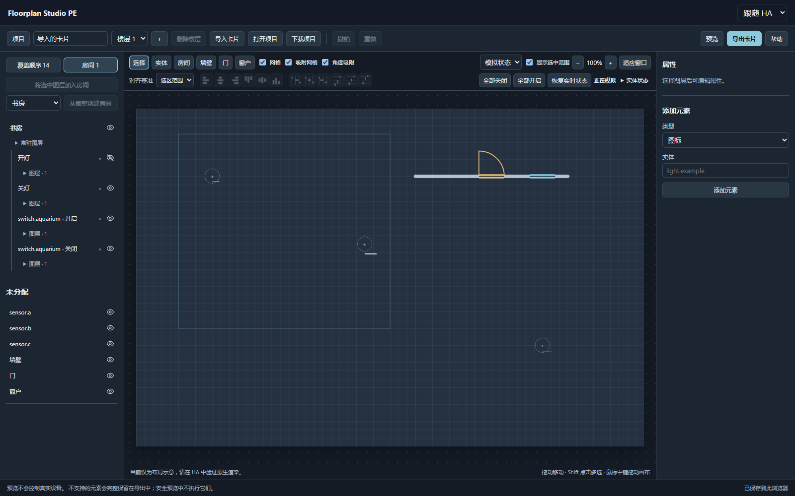

# Floorplan Studio PE

An independent fork of [Floorplan Studio](https://github.com/tinkersoder/floorplan-studio), based on upstream `b21c1a8ff416f4fd609d11a3564cc436d043f9db`. Original MIT license and copyright retained.

Version **0.3.0-beta.3** unifies card editing and drawing: one project library, canvas, selection, property panel, save flow and undo history. Start with a blank drawing, a background image or an existing `picture-elements` card. Includes Simplified Chinese, English and Follow HA language options.

## Install / update

Add `https://github.com/SeanChengN/floorplan-studio-pe` to HACS custom repositories, category **Dashboard**, enable beta versions and install `v0.3.0-beta.3`. Refresh your browser. The JavaScript module resource remains `/hacsfiles/floorplan-studio-pe/floorplan-studio-pe.js`.

Manual installation: copy the release JS into `/config/www/floorplan-studio-pe/` and register `/local/floorplan-studio-pe/floorplan-studio-pe.js?v=0.3.0-beta.3` as a JavaScript module.

```yaml
type: custom:floorplan-studio-pe-card
height: 90vh
```

Use a separate panel view for desktop editing. Download your current project before updating; beta.2 remains a rollback point and cannot open v3 project files.

## Unified workspace

- Room tree directly lists named states and their layers. Click a state to simulate; the eye temporarily hides content. Independent lights can be combined, and shared entities use the same simulated value. No device actions are executed.
- Classify existing conditions and state-image mappings without changing native configuration. Explicit display-rule changes require confirmation and retain nested conditions.
- Draw rooms, walls, doors and windows on the imported card; edit room vertices and wall geometry, with attached openings following the wall. Place entities by clicking the canvas. Grid, angle snapping, cursor wheel zoom and space/middle-button pan share the same viewport.
- Twelve alignment/distribution icons remain visible. Selection, key-object and canvas references use measured bounds, including simple polygon clips and linked elements.
- Native card objects remain authoritative. Unknown fields, images, clipping, actions and conditions survive semantic round trips. Exported cards remain standard `picture-elements` and do not require this editor.



## Projects and compatibility

All projects use a v3 library, with multiple floors, automatic browser saves, downloadable project files and a recoverable recycle area. v1/v2 native projects and legacy drawing projects migrate with recovery backups; old localStorage and IndexedDB data remain intact. Importing an existing project ID creates a separate copy. Temporary visibility is outside content undo/redo.

Legacy source data and its original exporters are preserved. Legacy marker styling/actions, advanced room rules/actions, transformed backgrounds and hidden categories may not map faithfully to native cards; native export is blocked with explicit reasons in those cases. The original drawing export is a **pre-migration snapshot**, not the result of subsequent workspace edits.

Save v3 project files to retain room classification, geometry bindings and editing metadata. Plain card YAML only retains rendering. Native HA preview is read-only; standalone preview is approximate. Unsupported custom elements and `card_mod` are preserved but not executed in safe preview. No automatic dashboard writes or full mobile editing. Use one editor per browser page.

See [Chinese installation guide](README.zh-CN.md), [workspace guide](docs/rooms-and-tools.zh-CN.md), and [validation evidence and limitations](VALIDATION.md).
