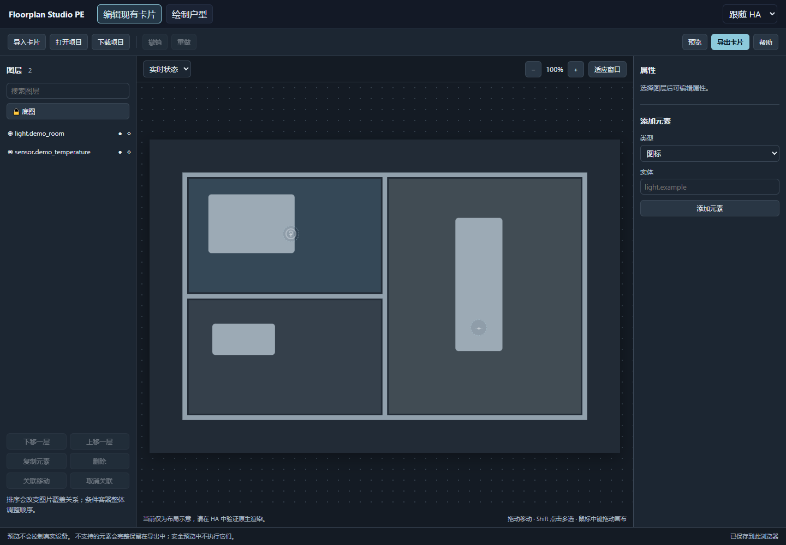

# Floorplan Studio PE

**Home Assistant 原生 Picture Elements 可视化编辑器 · 简体中文 / English**

在电脑上导入现有 `picture-elements` 卡片，拖动实体、管理图层并导出配置，保留原有灯光图片叠加与条件逻辑。最终卡片继续使用 HA 原生渲染。编辑器不会自动替换仪表盘或操作真实设备。

An independent fork of [Floorplan Studio](https://github.com/tinkersoder/floorplan-studio) by Tinker Söder. Edit existing native cards without losing unknown configuration, while retaining the original drawing mode. MIT license and upstream attribution are preserved.



使用内置合成示例展示编辑器布局，不包含私人户型、实体或 HA 配置。Synthetic demo showing the editor layout; no private floorplan or Home Assistant configuration is included.

## HACS 安装 / Installation

1. 在 HACS 的 **自定义仓库 / Custom repositories** 添加：

   **https://github.com/SeanChengN/floorplan-studio-pe**

2. 类型选择 **仪表盘 / Dashboard**（旧版为 Lovelace / Frontend）。
3. 找到 **Floorplan Studio PE**，启用 **显示测试版 / Show beta versions**，安装 `v0.2.0-beta.1`。
4. 刷新浏览器，在独立页面添加手动卡片，建议采用面板视图：

   ```yaml
   type: custom:floorplan-studio-pe-card
   height: 90vh
   ```

If HACS does not register the JavaScript module automatically, add `/hacsfiles/floorplan-studio-pe/floorplan-studio-pe.js` in dashboard resources. The repository, resource and custom-card names are distinct from upstream, so both installations can coexist.

## 功能 / Features

- 完整导入单张卡片 YAML/JSON；保留未知字段、条件层级、动作与样式。
- 实体拖动、多选、关联移动、属性编辑、复制和删除。
- 图层命名、锁定、临时隐藏、同级排序，撤销/重做。
- 项目自动保存与文件导入/导出；编辑信息不进入 HA 配置。
- HA 原生只读预览，支持实时状态和本地灯光模拟。
- 两种编辑模式均支持简体中文、English 和跟随 HA。

## 文档 / Documentation

- [中文安装与使用说明](README.zh-CN.md)
- [English guide](README-PE.md)
- [Validation and known limitations](VALIDATION.md)
- [Release notes](RELEASE-NOTES.md)
- [Original upstream documentation](README-UPSTREAM.md) — upstream installation names differ; use the instructions above for this fork.

**Beta:** Known dependency advisories remain, including the YAML parser and development toolchain. Import trusted configurations only; see the validation record. HACS installation and the import → move entity icon → export workflow have passed user testing; other features still need manual acceptance. No automatic dashboard writes, full mobile editing or polygon-vertex editing in this release.
